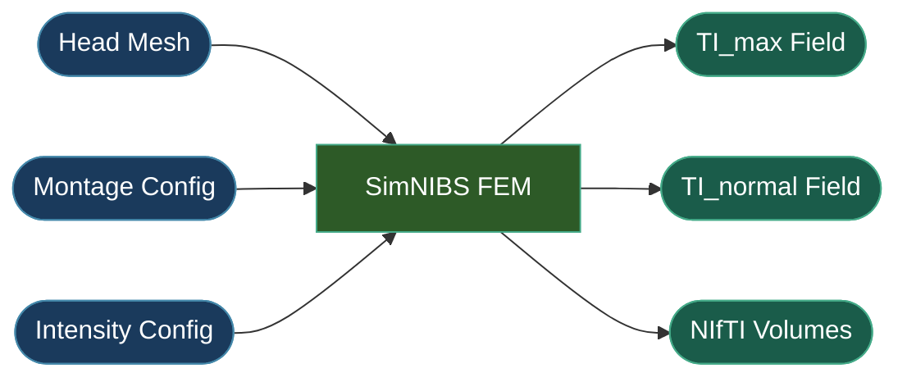

# Simulation

The simulation engine runs finite element method (FEM) calculations using SimNIBS to compute temporal interference electric fields in the brain. TI-Toolbox supports two simulation modes: **TI** (2 channels) and **mTI** (4 or more channels, even). A channel is one electrode pair, electrodes Ek+ and Ek-.



## Running a Simulation

```python
from tit.sim import (
    SimulationConfig, Montage,
    run_simulation, load_montages,
)

# Load montages from the project's montage_list.json
montages = load_montages(
    montage_names=["motor_cortex"],
    eeg_net="GSN-HydroCel-185",
)

# Configure the simulation (montages are part of the config)
config = SimulationConfig(
    subject_id="001",
    montages=montages,
    conductivity="scalar",
    intensities=[1.0, 1.0],
    electrode_shape="ellipse",
    electrode_dimensions=[8.0, 8.0],
    gel_thickness=1.0,
)

# Run (auto-detects TI vs mTI from the number of channels)
results = run_simulation(config)
```

## Simulation Modes

The simulation mode is auto-detected from the montage configuration:

| Mode | Channels | Description |
|------|----------|-------------|
| **TI** | 2 | Standard temporal interference — two channels at slightly different carrier frequencies that beat at Δf |
| **mTI** | 4 or more (even) | Multi-channel TI — 4 or more channels, beating in pairs at a common Δf; `mTI_max` is the joint envelope of all channels (`tit.calc.envelope_max`), not a recursive TI of TIs |

!!! info "Auto-Detection"
    You do not need to specify the mode manually. TI-Toolbox inspects the montage: 2 channels triggers TI mode, 4 or more (even) triggers mTI mode.

## Montage Configuration

Montages define which electrodes form each channel (`electrode_pairs`, one pair per channel). They are stored in `montage_list.json` within your project:

```json
{
  "nets": {
    "GSN-HydroCel-185": {
      "uni_polar_montages": {
        "motor_cortex": [["E36", "E224"], ["E104", "E148"]]
      }
    }
  }
}
```

Load montages programmatically:

```python
from tit.sim import load_montages

montages = load_montages(
    montage_names=["motor_cortex", "frontal_target"],
    eeg_net="GSN-HydroCel-185",
)
```

## Conductivity Types

The `conductivity` field on `SimulationConfig` accepts one of four string values:

| Value | Description |
|-------|-------------|
| `"scalar"` | Isotropic, piecewise-constant conductivity (default, faster) |
| `"vn"` | Volume-normalized anisotropic conductivity from DTI data |
| `"dir"` | Direct linear rescaling of diffusion tensor eigenvalues |
| `"mc"` | Mean-conductivity (isotropic but spatially varying, from DTI) |

## Electrode Configuration

Electrode parameters are flat fields on `SimulationConfig`:

```python
config = SimulationConfig(
    ...,
    electrode_shape="ellipse",         # "ellipse" or "rect"
    electrode_dimensions=[8.0, 8.0],   # [width, height] in mm
    gel_thickness=1.0,                  # gel layer thickness in mm
    rubber_thickness=2.0,              # rubber layer thickness in mm
)
```

## Output Fields

After simulation, TI-Toolbox produces several derived field types:

| Field | Description |
|-------|-------------|
| **TI_max** | Maximum TI envelope over all directions — scalar field on volume elements (TI mode) |
| **TI_normal** | TI envelope along the cortical surface normal — node field on the central surface `mesh/surfaces/<montage>_<TI|mTI>_central.msh` |
| **mTI_max** | Maximum joint envelope of all channels — scalar field on volume elements (mTI mode) |
| **hf_peak**, **hf_rms** | Saved by default with `TI_max`/`mTI_max` (`output_fields=None`): peak carrier field (V/m, zero-to-peak; the one to compare with exposure limits), `hf_rms` = √`tit.calc.hf_power`, the RMS carrier field (V/m; not a compliance metric) |
| **TI_avg**, **hf_power_density** | Opt-in volume fields (`output_fields`): direction-averaged envelope, absorbed carrier power with the run's conductivity (W/m³) |

The selected fields are written into one field mesh, `<montage>_TI.msh` (`<montage>_mTI.msh`), and
onto its central surface with `TI_normal` (`tit.volume_fields.central_surface`). NIfTI volumes are
opt-in: `map_to_vol=True` writes one 3-D NIfTI per mesh field for the whole brain tissue and its
grey- and white-matter parts (`map_to_mni=True`, which needs it, adds MNI copies). A field or NIfTI an
analysis or group tool needs and the run did not save is computed from the kept channel meshes
(`high_Frequency/mesh/`) and saved by `tit.volume_fields` (`ensure_mesh_fields`, `ensure_niftis`),
except `hf_power_density`, whose conductivity is not kept.

## Output Directory Structure

```
derivatives/SimNIBS/sub-001/Simulations/
└── motor_cortex/
    ├── documentation/        # config.json, SimNIBS session log
    ├── high_Frequency/
    │   ├── mesh/             # Per-channel SimNIBS meshes and electrode-current .geo files
    │   ├── niftis/           # Per-channel magnE NIfTI volumes (map_to_vol)
    │   └── analysis/         # fields_summary.txt
    ├── TI/                   # (mTI/ instead for an mTI run, mTI_max in place of TI_max)
    │   ├── mesh/motor_cortex_TI.msh                    # every selected volume field
    │   ├── mesh/surfaces/motor_cortex_TI_central.msh   # those fields + TI_normal, lh then rh
    │   ├── niftis/           # NIfTI volumes (map_to_vol, or written on demand)
    │   └── montage_imgs/     # Electrode placement visualizations
    ├── fsaverage/            # map_to_fsavg
    └── Analyses/             # Analyzer outputs
```

## API Reference

::: tit.sim.config.SimulationConfig
    options:
      show_root_heading: true
      members_order: source

::: tit.sim.config.Montage
    options:
      show_root_heading: true
      members_order: source

::: tit.sim.config.MontageMode
    options:
      show_root_heading: true

::: tit.sim.config.SimulationMode
    options:
      show_root_heading: true

::: tit.sim.config.parse_intensities
    options:
      show_root_heading: true

::: tit.sim.base.BaseSimulation
    options:
      show_root_heading: true
      members_order: source

::: tit.sim.utils.run_simulation
    options:
      show_root_heading: true

::: tit.volume_fields.ensure_mesh_fields
    options:
      show_root_heading: true

::: tit.volume_fields.ensure_niftis
    options:
      show_root_heading: true

::: tit.volume_fields.FieldUnavailableError
    options:
      show_root_heading: true

::: tit.sim.utils.load_montages
    options:
      show_root_heading: true

::: tit.sim.utils.list_montage_names
    options:
      show_root_heading: true

::: tit.sim.utils.load_montage_data
    options:
      show_root_heading: true

::: tit.sim.utils.save_montage_data
    options:
      show_root_heading: true

::: tit.sim.utils.ensure_montage_file
    options:
      show_root_heading: true

::: tit.sim.utils.upsert_montage
    options:
      show_root_heading: true
